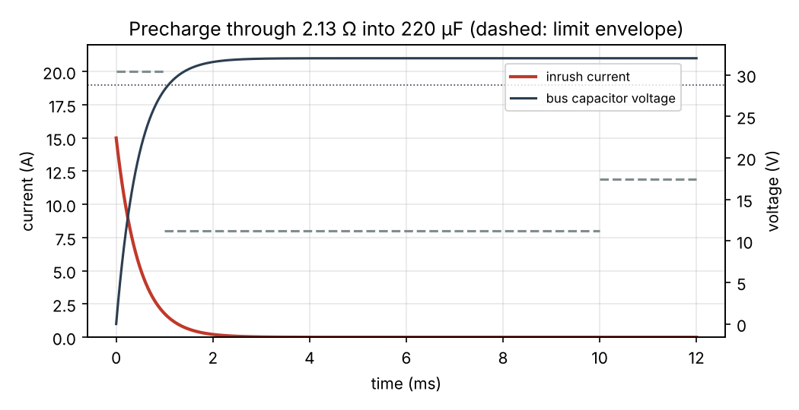
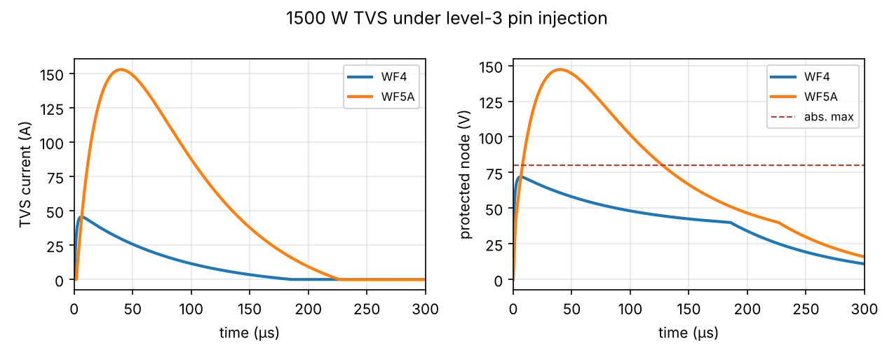
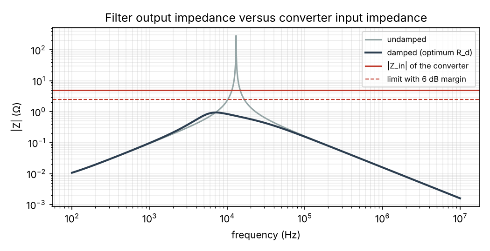
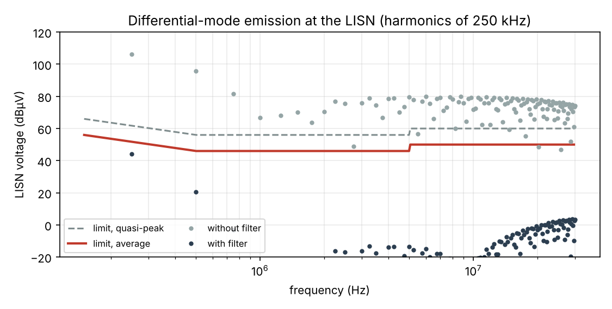
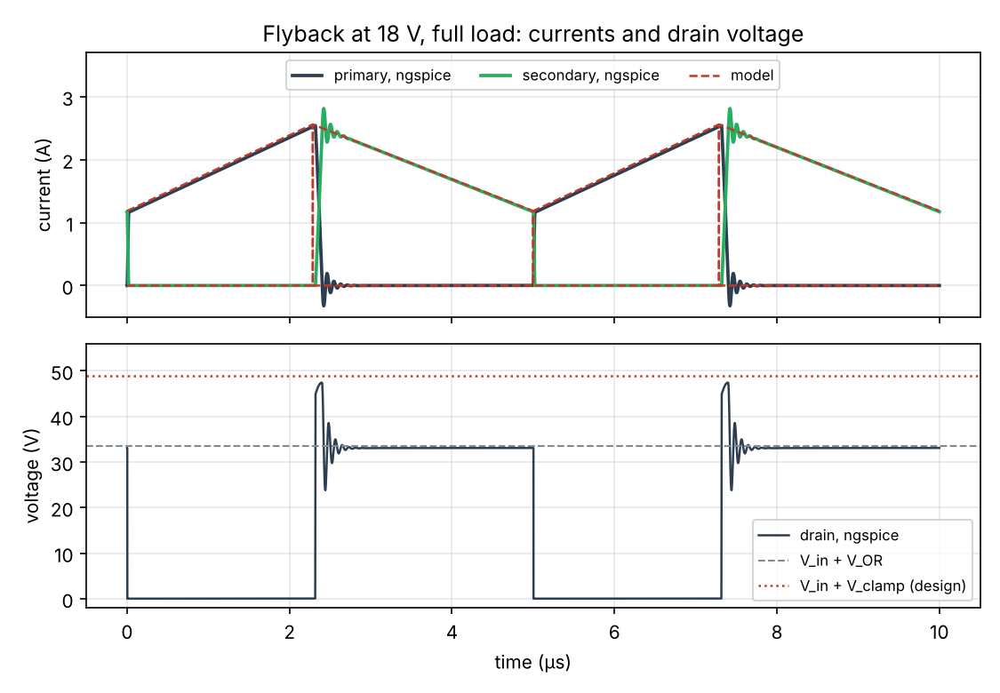
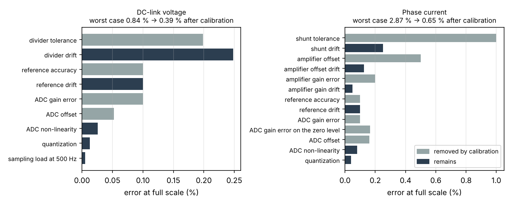
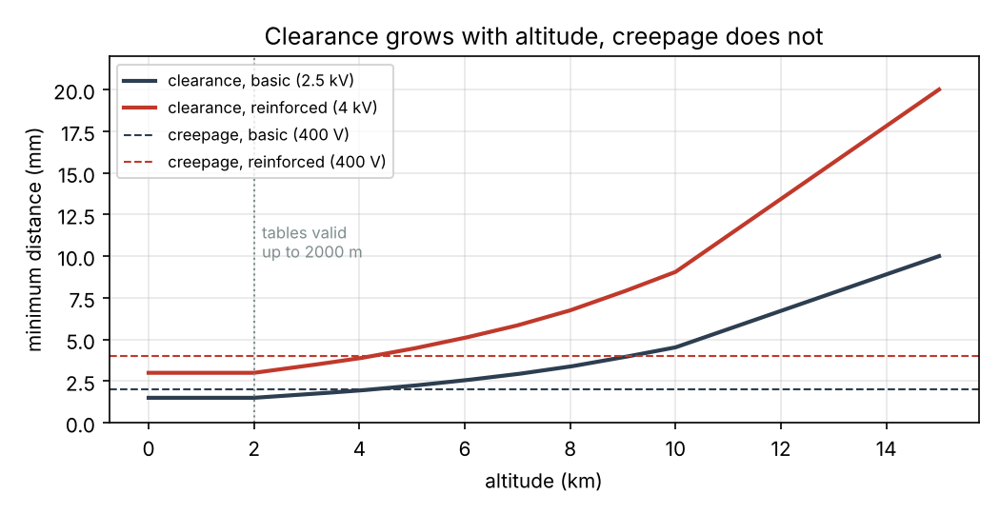

# hardware-design-kit

[](https://github.com/mehdi-belhaj-eea/hardware-design-kit/actions/workflows/ci.yml)

Design calculators for the power side of an electronic board: input protections (inrush
precharge, reverse polarity, lightning and surge, ESD, hold-up), the EMI filter with its damping
and stability check, a flyback converter and its transformer, voltage and current measurement
chains, and PCB rules (trace width, clearance and creepage with altitude). Written in Python;
every model is checked against closed-form results and ngspice simulations in the test suite.

> Personal self-training project (2026). All values in the examples are illustrative: no data
> from any employer, customer or program is used.

## What it covers

| Module | What it sizes or checks |
| --- | --- |
| `hdk.protection.precharge` | Precharge resistor, time constant, bypass time, pulse energy in the resistor, inrush envelope |
| `hdk.protection.reverse` | Schottky diode versus MOSFET ("ideal diode"): drop and losses with R_DS(on) at temperature |
| `hdk.protection.surge` | Double-exponential transient source (DO-160G Section 22, IEC 61000-4-5), TVS clamp, pulse-power check, required rating |
| `hdk.protection.esd` | IEC 61000-4-2 currents, clamp and rating check, capacitance budget of a data line |
| `hdk.protection.holdup` | Hold-up energy, minimum and nominal capacitance (tolerance, ageing), direct versus boosted storage |
| `hdk.emi.spectrum` | Harmonics of trapezoidal switching waveforms and their envelope |
| `hdk.emi.limits` | Conducted-emission limit lines (CISPR 32 class B as a reference), margins |
| `hdk.emi.filters` | DM π filter with parasitics, optimum damping, Middlebrook stability, CM choke and Y capacitors |
| `hdk.power.flyback` | Flyback in CCM and DCM: turns ratio, magnetising inductance, peak and RMS currents, voltage stresses, RCD clamp, output capacitor, right-half-plane zero, ngspice netlist |
| `hdk.magnetics` | Flyback transformer: turns, gap with fringing, iGSE core loss, wire choice, Dowell AC resistance per harmonic, copper fill, temperature rise |
| `hdk.measure` | Divider and shunt chains, ADC kick-back and settling, error budgets before and after calibration |
| `hdk.pcb` | IPC-2221 trace width and vias; IEC 60664-1 clearance and creepage, altitude correction, reinforced insulation |

The equations and assumptions are in [docs/methods.md](docs/methods.md).

## Worked examples

### 1. 28 V aircraft-style input protections — [full report](docs/example_aero_28v.md)

| Check | Result |
| --- | --- |
| Precharge of 220 µF at 32 V, 15 A max | 2.13 Ω, τ = 0.47 ms, 112 mJ pulse in the resistor; inrush envelope met |
| Reverse polarity at 9.3 A | Schottky 5.1 W, MOSFET 0.5 W |
| 1500 W TVS, pin injection level 3, WF4 (300 V, 5 Ω) | 46 A, clamped at 72 V: pass |
| Same TVS, WF5A (300 V, 1 Ω) | 153 A, 147 V: fail. The protection must carry 220 A with R_d ≤ 182 mΩ |
| Hold-up, 20 ms at 150 W | 20.1 mF on the 28 V bus, or 2.9 mF on a 60 V storage bus |

 

### 2. 48 V industrial buck converter, input EMI filter — [full report](docs/example_industrial_48v.md)

| Step | Result |
| --- | --- |
| DM attenuation needed at 250 kHz (6 dB margin) | 60.6 dB, corner f0 ≤ 7.6 kHz |
| DM filter | L_f = 15 µH, C_f = 7 × 4.7 µF; worst margin 7.5 dB |
| Damping across the converter's 10 µF | R_d = 688 mΩ + C_d = 47 µF |
| Middlebrook check at 36 V, 240 W | peak \|Z_o\| = 0.94 Ω against a 2.48 Ω limit (undamped: 300 Ω) |
| Common mode, 30 pF to chassis | 1 mH choke + 2 × 22 nF: worst margin 7.0 dB |

 

### 3. Isolated 15 V auxiliary flyback from a 28 V bus — [full report](docs/example_flyback_28v.md)

| Step | Result |
| --- | --- |
| Turns and inductance (18–32 V in, 15 V / 1 A out, 200 kHz) | 11 : 11 on an EFD20-class core, L_m = 29.5 µH, total gap 0.16 mm (fringing included) |
| Currents at 18 V, full load | CCM, D = 0.463, primary peak 2.83 A, RMS 1.47 A |
| Stresses | drain 63 V with an RCD clamp dissipating 0.71 W, rectifier 47 V |
| Transformer | 0.244 T peak, core 0.11 W (iGSE), copper 0.47 W including 0.21 W of eddy loss in the idle primary, about 38 K rise |
| Switching simulation at 18 V (ngspice) | primary peak 2.543 A simulated, 2.559 A from the model |



### 4. Voltage and current measurement chains — [full report](docs/example_measurement.md)

| Chain | Worst case / RSS, as built | After calibration |
| --- | --- | --- |
| DC link 0–500 V: 4 × 249 kΩ + 6.19 kΩ into a 12-bit ADC | ±0.84 % / ±0.37 % | ±0.39 % / ±0.27 % |
| Phase current ±20 A: 1 mΩ shunt, gain 50 | ±2.87 % / ±1.21 % | ±0.65 % / ±0.31 % |

Without a buffer, the divider needs at least 123 nF at the ADC input to absorb the sampling
kick-back (bandwidth about 170 Hz), and its 6.15 kΩ source limits the sample rate to about 1.3 kHz
per channel: fine for monitoring, not for a fast control loop or a protection.



### 5. PCB rules — [full report](docs/example_pcb_rules.md)

| Check | Result |
| --- | --- |
| 5 A, 1 oz copper, 10 °C rise (IPC-2221) | 2.77 mm external, 7.19 mm internal; 6 vias of Ø0.3 mm |
| 400 V DC link behind a single-phase 230 V PFC, OVC II, pollution degree 2 | basic 1.5 mm clearance / 2.0 mm creepage; reinforced 3.0 / 4.0 mm |
| Same board at 5000 m | reinforced clearance 4.44 mm, which now sets the creepage too |



## Validation

- **Tests** (`pytest`, 76 tests): closed-form checks of every calculator, and cross-checks
  against **ngspice**: precharge transient, TVS clamp, DM noise path from 1 kHz to 30 MHz with
  all parasitics (difference below 0.05 dB), filter output impedance, and a switching simulation
  of the flyback at both ends of the input range (peak current, current slope, clamp voltage).
- **Optimum damping**: the closed-form R_d is compared with a numerical minimisation of the
  output-impedance peak.
- **Core loss**: the iGSE is checked against the Steinmetz equation for a sine and against
  numerical integration for a triangle.
- **Standalone netlists** in [spice/](spice/) reproduce the examples and print their results
  with `.meas`.
- **CI**: GitHub Actions runs the tests and all the examples on Python 3.10 and 3.12, with ngspice.

## Quick start

```bash
git clone https://github.com/mehdi-belhaj-eea/hardware-design-kit.git
cd hardware-design-kit
pip install -e ".[dev]"
pytest                                  # ngspice tests are skipped if ngspice is not installed
python examples/aero_28v_protection.py
python examples/industrial_48v_emi.py
python examples/aux_flyback_28v.py
python examples/measurement_chains.py
python examples/pcb_rules.py
```

```python
from hdk.protection import precharge, surge

d = precharge.design_precharge(v_bus=32.0, c_bus=220e-6, i_peak_max=15.0)
print(f"R = {d.r_pre:.2f} ohm, tau = {d.tau * 1e3:.2f} ms, E_R = {d.energy_resistor * 1e3:.0f} mJ")

wf4 = surge.double_exponential(t_peak=6.4e-6, t_half=69e-6)
tvs = surge.TVS("1500 W, 36 V", v_wm=36.0, v_br=40.0, v_c=58.1, i_pp=25.8, p_pp=1500.0)
r = surge.clamp_response(tvs, v_oc=300.0, r_source=5.0, wave=wf4)
print(f"TVS current {r.i_peak:.0f} A, clamped at {r.v_peak:.0f} V")
```

## Limits

- Ideal trapezoidal waveforms: ringing, diode recovery and layout resonances are not modelled.
- Linearised TVS and a t^(−1/2) pulse-power estimate: confirm with the datasheet curves.
- Flyback: losses lumped into an efficiency, leakage inductance as an input, open-loop simulation.
  Core-loss exponents and bobbin data in the examples are assumptions: take them from the data sheets.
- IEC 60664-1 values are transcribed for the cases implemented (clearance case A, printed wiring
  creepage, pollution degrees 1 and 2): check them against the edition you apply, and against the
  product standard.
- CISPR 32 is used as a well-known public reference. Use the limit that applies to the product
  (DO-160 Section 21, MIL-STD-461 CE102, CISPR 25, ...).
- These calculators help size and review a design; they do not replace qualification tests.

## Roadmap

- [x] Input protections and EMI filter (0.1)
- [x] Flyback converter and transformer design; voltage and current measurement chains (0.2)
- [x] PCB rules: trace width and temperature rise (IPC-2221), creepage and clearance (IEC 60664-1, altitude correction) (0.2)
- [ ] KiCad 4-layer board applying these rules

## About

Mehdi Belhaj, power electronics and embedded systems engineer, Toulouse —
[mehdi-belhaj-eea.github.io](https://mehdi-belhaj-eea.github.io)

I used an AI assistant (Claude) to help write the code and documentation. The equations are
written out in [docs/methods.md](docs/methods.md), and every result is checked by the tests.

Licence: MIT.

---

### En bref (français)

Calculateurs pour la partie puissance d'une carte électronique : protections d'entrée
(précharge, inversion de polarité, foudre et surtensions, ESD, maintien), filtre CEM de mode
différentiel et de mode commun avec amortissement et critère de stabilité de Middlebrook,
convertisseur flyback et son transformateur (entrefer, pertes fer par iGSE, pertes cuivre par
Dowell), chaînes de mesure de tension et de courant avec budget d'erreur, et règles PCB (largeur
de piste IPC-2221, distances d'isolement IEC 60664-1 avec correction d'altitude). Chaque modèle
est vérifié par des tests, dont des comparaisons avec ngspice. Cinq exemples complets. Projet
personnel d'autoformation ; toutes les valeurs sont illustratives.
