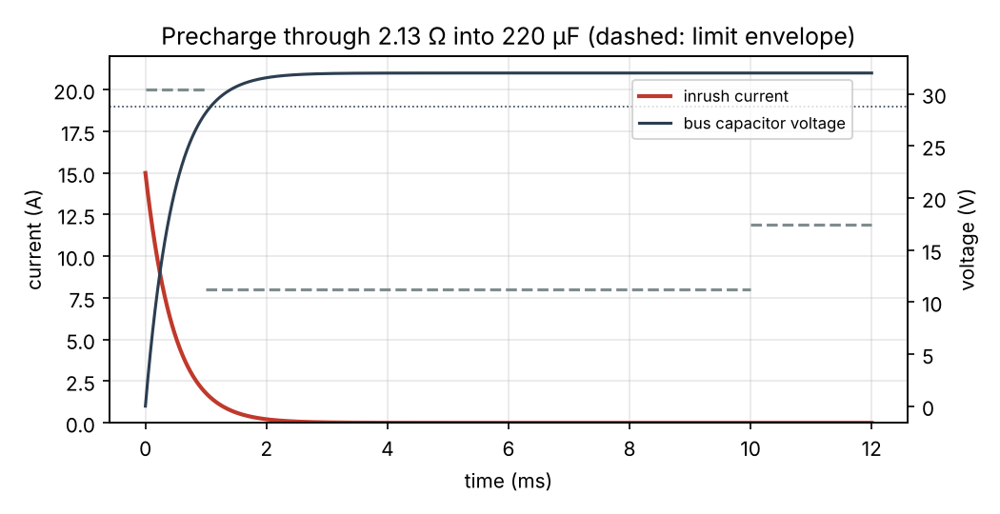
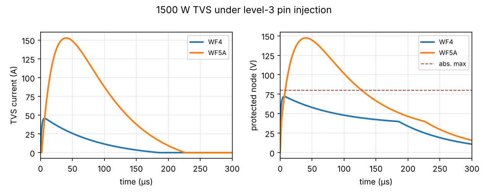

# Example 1 — 28 VDC input protections (illustrative values)

Bus 28 V nominal (18–32 V), load 150 W at η = 0.90, bulk capacitance 220 µF.

## 1. Precharge (inrush limiting)

Sized at the maximum bus voltage, where the peak current V/R is highest.

| Quantity | Value |
| --- | --- |
| Resistor R = V_max / I_peak | 2.13 Ω |
| Time constant τ = R·C | 0.469 ms |
| Bypass at 90 % of V_max after | 1.081 ms |
| Energy in R until bypass | 111.5 mJ |
| Average power in R until bypass | 103.2 W |
| Voltage step when the bypass closes | 3.2 V |

Check against the (illustrative) inrush envelope:

| Window | Worst current | Limit | Result |
| --- | --- | --- | --- |
| 0–1 ms | 15.00 A | 20.0 A | pass |
| 1–10 ms | 1.78 A | 8.0 A | pass |
| 10–1000 ms | 0.00 A | 11.9 A | pass |

Pick a resistor rated for the pulse energy above (pulse-load or wire-wound type), and repeat the energy check for the worst case: a restart before the capacitor has discharged.

## 2. Reverse-polarity protection

Worst-case input current at 18 V: 9.26 A.

| Solution | Drop | Loss |
| --- | --- | --- |
| Schottky diode, V_F = 0.55 V | 0.55 V | 5.09 W |
| MOSFET 4 mΩ at 25 °C (5.8 mΩ at 100 °C) | 54 mV | 0.50 W |

The MOSFET dissipates 10 times less and keeps more input voltage for the converter.

## 3. Lightning transients (pin injection, level 3)

Candidate: 1500 W TVS, 36 V stand-off (example datasheet values): V_BR = 40 V, V_C = 58.1 V at 25.8 A, so R_d = 0.70 Ω. Downstream absolute maximum: 80 V.

| Waveform | Source | Peak current | Clamped voltage | Peak power | Estimated rating | Result |
| --- | --- | --- | --- | --- | --- | --- |
| WF4 6.4/69 µs | 300 V / 60 A (5 Ω) | 46 A | 72 V | 3.3 kW | 5.7 kW | pass |
| WF5A 40/120 µs | 300 V / 300 A (1 Ω) | 153 A | 147 V | 22.5 kW | 4.3 kW | FAIL |

The 1500 W part passes WF4 but not WF5A: the 1 Ω source pushes far more current. To stay below 80 V, the protection must carry 220 A (17.6 kW peak) with a dynamic resistance of at most 182 mΩ: a high-power TVS (or several in parallel, matched) is needed. WF5A drives the choice on power inputs fed by long harnesses.

The pulse-power rating is a first estimate (P ∝ t^-1/2 from the 10/1000 µs value); confirm with the datasheet derating curve.

## 4. Hold-up

Energy for 20 ms at 150 W (η = 0.9): 3.33 J.

| Storage | Voltage window | Nominal capacitance (−20 % tolerance, −10 % ageing) |
| --- | --- | --- |
| On the 28 V bus | 28 → 18 V | 20.1 mF |
| Boosted storage bus | 60 → 20 V | 2.89 mF |

Storing at 60 V divides the capacitance by 7.0, because the usable energy grows with V².
