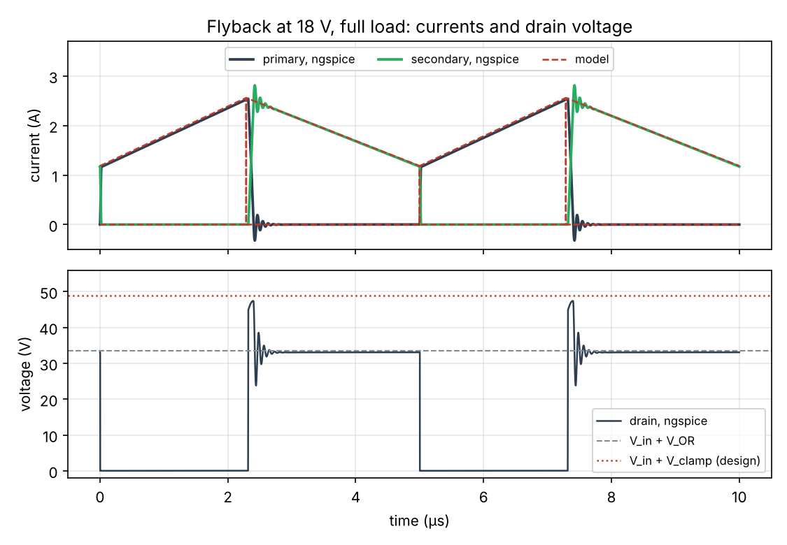

# Example 3 — 15 V auxiliary flyback from a 28 V bus (illustrative values)

Input 18–32 V, output 15 V / 1 A (15 W, isolated), 200 kHz. Sizing assumptions: efficiency 85 %, rectifier drop 0.5 V, duty cycle 0.45 at minimum input, ripple ratio K_RP = 0.5 (continuous mode at full load).

## 1. Turns ratio and magnetising inductance

The ideal ratio is n = N_p/N_s = 0.950. With whole turns, the fewest that keep the peak flux density below 0.25 T are N_p : N_s = 11 : 11, so the converter is redesigned with n = 1.000: V_OR = 15.5 V and L_m = 29.5 µH.

| Operating point | 18 V, full load | 32 V, full load |
| --- | --- | --- |
| Mode | CCM | CCM |
| Duty cycle | 0.463 | 0.326 |
| Primary current: peak / valley / RMS | 2.83 / 1.41 / 1.47 A | 2.58 / 0.80 / 1.01 A |
| Secondary current: peak / RMS | 2.83 / 1.58 A | 2.58 / 1.45 A |
| Output capacitor RMS current | 0.96 A | 0.79 A |

## 2. Voltage stresses and RCD clamp

Leakage inductance assumed at 1.5 % of L_m (0.44 µH). Clamp voltage 2 × V_OR = 31.0 V above the input.

| Quantity | Value |
| --- | --- |
| Drain voltage before the leakage spike (V_in,max + V_OR) | 47.5 V |
| Drain peak with the clamp (V_in,max + V_clamp) | 63.0 V |
| Rectifier reverse voltage (V_out + V_in,max/n) | 47.0 V |
| Clamp power | 0.71 W |
| Clamp resistor / capacitor (10 % ripple) | 1.36 kΩ / 37 nF |

A 100 V MOSFET keeps 59 % headroom over the clamped drain peak. The rectifier sees 47 V plus its turn-off ringing, so a 100 V Schottky is the safe choice. The clamp dissipates 5 % of the output power: interleaved windings, which lower the leakage, pay back directly here.

## 3. Transformer on an EFD20-class core

Core A_e = 31 mm², l_e = 47 mm, V_e = 1460 mm³; bobbin (assumed): winding area 25 mm², width 12.5 mm, mean turn 34 mm. Material: N87-class ferrite at 100 °C, 375 kW/m³ at 100 kHz and 200 mT, α = 1.4, β = 2.6.

| Quantity | Value |
| --- | --- |
| Turns N_p : N_s | 11 : 11 |
| Total air gap (fringing factor 1.14 included) | 0.16 mm |
| Peak flux density | 0.244 T (saturation 0.39 T: margin × 1.6) |
| Largest flux swing (peak to peak) | 0.153 T |
| Core loss (iGSE, triangular flux) | 0.11 W |
| Primary (inner): 4 × Ø0.315 mm, 2 layers | J = 4.7 A/mm², R_dc = 27 mΩ at 100 °C; loss 0.13 W from its own current (×2.2 the DC loss) + 0.21 W induced by the secondary field |
| Secondary (outer): 5 × Ø0.315 mm, 2 layers | J = 4.1 A/mm², R_dc = 22 mΩ; loss 0.12 W (×2.3 the DC loss) |
| Copper fill factor | 31 % |
| Total loss and temperature rise (estimate) | 0.11 W core + 0.47 W copper = 0.58 W, about 38 K |

Strands thinner than two skin depths keep the skin effect low, but the harmonics of the trapezoidal currents and the proximity effect between layers still multiply the copper loss: Dowell's factor is applied harmonic by harmonic. The windings of a flyback never conduct together, so nothing cancels the field of the conducting one: while the secondary conducts, its full field crosses the primary wound next to the gapped centre leg, which loses 0.21 W although it carries no current. Interleaving (half primary, secondary, half primary) cuts this loss and the leakage inductance. With a spacer under all three legs, the spacer is half the total gap.

## 4. Output capacitor and control loop

For 150 mV of ripple: effective capacitance ≥ 19 µF (ceramic, after DC-bias derating), ESR ≤ 11 mΩ, RMS current 0.96 A.

Right-half-plane zero at 18 V and full load: 51 kHz. Cross the loop over below about 10 kHz.

## 5. Check against a switching simulation (ngspice)

Open loop at the design duty cycle, with the 1.5 % leakage, the RCD clamp, a Schottky-like rectifier and 22 µF at the output (netlist: `hdk.power.flyback.spice_netlist`). The model is evaluated at the simulated output power and efficiency.

| Input | Output (open loop) | Efficiency | Primary peak: simulation / model | Clamp voltage: simulation / formula | Drain peak |
| --- | --- | --- | --- | --- | --- |
| 18 V | 14.66 V | 93.0 % | 2.543 A / 2.559 A | 27.3 V / 28.9 V | 47.4 V |
| 32 V | 14.81 V | 93.2 % | 2.365 A / 2.380 A | 26.1 V / 27.7 V | 60.1 V |

The simulated converter has no core or switching losses, so it runs above the 85 % assumed for sizing. The clamp formula ignores the snubber and the switch capacitance, which absorb part of the leakage energy.

