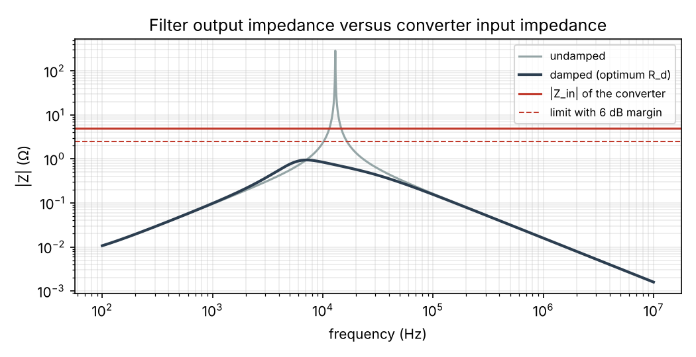
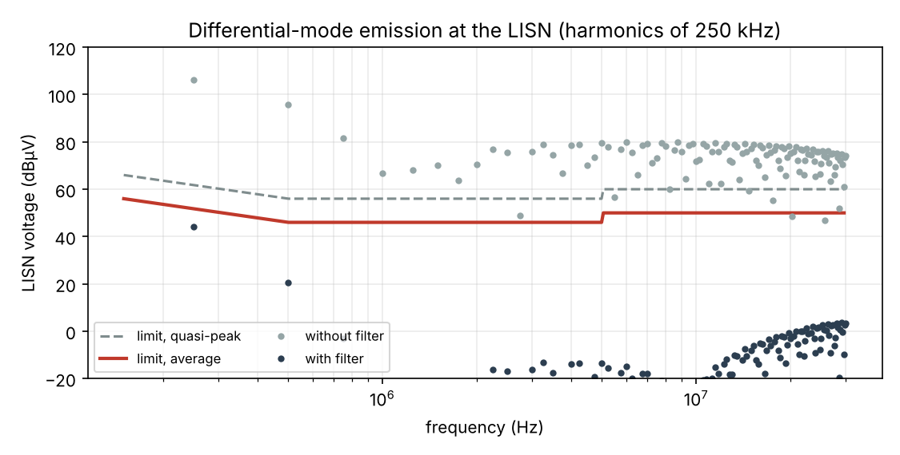
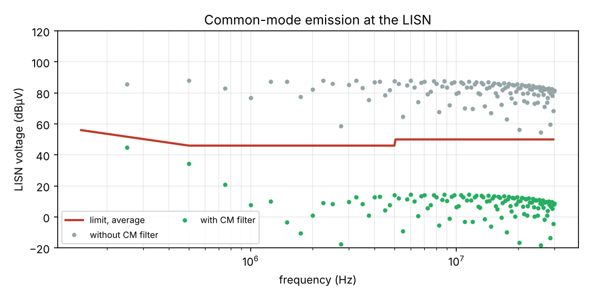

# Example 2 — 48 V input EMI filter (illustrative values)

Buck 48 V → 12 V, 20 A (240 W), f_sw = 250 kHz, D = 0.272, edges 20 ns, converter input ceramics 10 µF.
Target: CISPR 32 class B, AC mains port, average, with 6 dB margin. A steady harmonic reads the same on the quasi-peak and average detectors, so the average limit is the one that binds.

## 1. Required attenuation (differential mode)

Without filter the worst point is 250 kHz: 106.4 dBµV against 51.8 dBµV, so 60.6 dB of attenuation is needed (margin included).
With 40 dB/decade above the corner: f0 ≤ 7.63 kHz.

## 2. Component values

Topology: LISN ─ C_f ─ L_f ─ converter C_in ∥ damping. Impedance level R0 = √(L_f/C_f) = 0.5 Ω.

| Element | Calculated | Chosen |
| --- | --- | --- |
| L_f | 10.43 µH | 15.0 µH (E6, rounded up) |
| C_f (for the same corner with the chosen L_f) | 29.0 µF | 32.9 µF = 7 × 4.7 µF ceramic |

Resulting corner: 7.16 kHz.

## 3. Damping and stability (Middlebrook)

On a stiff bus the converter sees L_f resonating with its own 10 µF (R0' = √(L_f/C_in) = 1.22 Ω). Damping branch across C_in: C_d = 47 µF (E6 above 4 × C_in, n = 4.7), R_d = 688 mΩ (closed-form optimum; the ESR of an electrolytic C_d can provide part of it).

Converter input impedance at 36 V, full load: |Z_in| = V²·η/P = 4.97 Ω.

| Filter | Peak output impedance |
| --- | --- |
| Undamped (only the 5 mΩ winding resistance) | 300 Ω |
| Damped | 0.94 Ω (closed form 0.95 Ω) |

Requirement with 6 dB margin: ≤ 2.48 Ω → pass. Undamped, the filter would make the converter oscillate.

## 4. Check with parasitics

Inductor 5 mΩ DCR and 20 pF parasitic capacitance; C_f bank 1 mΩ ESR and 0.5 nH ESL (including layout).

Worst margin to the average limit: 7.5 dB at 0.25 MHz (meets the 6 dB target).

Above a few MHz the inductor's parasitic capacitance and the capacitors' ESL limit the attenuation: keep the filter compact and away from the switching cell.

## 5. Common mode

Switching node 48 V with 20 ns edges, 30 pF to chassis (i = C·dv/dt). Without filter the worst point is 250 kHz, 39.9 dB above the target (margin included).

With Y capacitors of 22 nF per line (2·C_Y for common mode), the corner must be below 25.1 kHz: L_CM ≥ 0.91 mH, chosen 1.0 mH (10 pF parasitic). Worst margin with the filter: 7.0 dB at 0.25 MHz.

The choke's parasitic capacitance bypasses it at high frequency: there, layout (short Y-capacitor loops, a low-impedance chassis connection) matters more than the component values.

