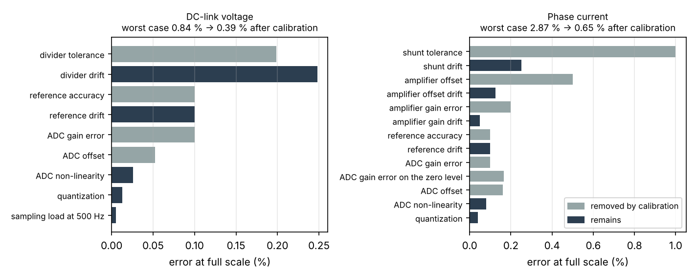

# Example 4 — Voltage and current measurement chains (illustrative values)

ADC: 12 bits, 3.3 V full scale, sampling capacitor 15 pF; reference ±0.1 % and 20 ppm/K; ADC gain error ±0.1 %, offset ±2 LSB, non-linearity ±1 LSB. Temperature span 50 K around the calibration point.

## 1. DC-link voltage (0 to 500 V)

Divider: 4 × 249 kΩ on top (0.1 %, 25 ppm/K, 1206), 6.19 kΩ at the bottom, all E96. Splitting the top resistor keeps each part within its voltage rating and spreads the creepage distance.

| Quantity | Value |
| --- | --- |
| Ratio | 0.00618 (500 V → 3.088 V, 94 % of the ADC range) |
| Each top resistor at 500 V | 124 V, 62 mW |
| Divider current at 500 V | 0.50 mA |
| Source resistance seen by the ADC | 6.15 kΩ |
| LSB referred to the DC link | 130 mV |

Sampling without a buffer (multiplexed SAR ADC, worst case: the previous channel left the sampling capacitor at 0 V) sets two separate limits:

- one sample: the filter capacitor must absorb the kick-back of the 15 pF sampling capacitor within ½ LSB, so C_f ≥ 123 nF. With 150 nF the filter corner is 172 Hz and a full-scale step settles to ½ LSB in 8.3 ms;
- repeated samples: each conversion draws a charge C_s·ΔV, an average current that the 6.15 kΩ source cannot supply without an error, whatever C_f is. For ½ LSB the sample rate must stay below 1323 Hz; at 500 Hz the error is in the budget below, at 10 kHz it would reach 0.10 % (3.8 LSB).

This front-end suits the monitoring of a slow bus. A control loop sampling at several kilohertz, or an overvoltage protection, needs an op-amp buffer after the divider (or its own comparator).

| Term | Error at full scale | Removed by calibration |
| --- | --- | --- |
| divider tolerance | ±0.199 % | yes |
| divider drift | ±0.248 % | no |
| reference accuracy | ±0.100 % | yes |
| reference drift | ±0.100 % | no |
| ADC gain error | ±0.100 % | yes |
| ADC offset | ±0.052 % | yes |
| ADC non-linearity | ±0.026 % | no |
| quantization | ±0.013 % | no |
| sampling load at 500 Hz | ±0.005 % | no |
| **Worst case / RSS, as built** | ±0.843 % / ±0.367 % | |
| **Worst case / RSS, after calibration** | ±0.393 % / ±0.269 % | |

In volts (all terms referred to the 500 V full scale): ±4.2 V worst case as built, ±2.0 V after calibration. What remains is drift: "divider drift" leads. A matched resistor network (tracking TCR) would shrink it.

## 2. Phase current (±20 A)

Shunt 1 mΩ (1 %, 50 ppm/K), current-sense amplifier gain 50 (offset 100 µV, 0.5 µV/K; gain error 0.2 %, 10 ppm/K), output referred to mid-scale (1.65 V) for a bidirectional current. The amplifier reference is derived from the ADC reference (ratiometric), so a reference error scales the current span only; the ADC gain error, which acts on the absolute input voltage, also shifts the mid-scale zero.

| Quantity | Value |
| --- | --- |
| Output at ±20 A | 0.65 V to 2.65 V |
| Measurable range | −33 A to +33 A |
| Shunt dissipation at 14.1 A rms | 0.20 W |
| LSB referred to the current | 16 mA |

| Term | Error at full scale | Removed by calibration |
| --- | --- | --- |
| shunt tolerance | ±1.000 % | yes |
| shunt drift | ±0.250 % | no |
| amplifier offset | ±0.500 % | yes |
| amplifier offset drift | ±0.125 % | no |
| amplifier gain error | ±0.200 % | yes |
| amplifier gain drift | ±0.050 % | no |
| reference accuracy | ±0.100 % | yes |
| reference drift | ±0.100 % | no |
| ADC gain error | ±0.100 % | yes |
| ADC gain error on the zero level | ±0.165 % | yes |
| ADC offset | ±0.161 % | yes |
| ADC non-linearity | ±0.081 % | no |
| quantization | ±0.040 % | no |
| **Worst case / RSS, as built** | ±2.872 % / ±1.209 % | |
| **Worst case / RSS, after calibration** | ±0.646 % / ±0.314 % | |

The amplifier offset alone is 100 mA: 10 % of a 1 A reading. Measuring the zero-current output at start-up (all switches off) removes it, which is why motor drives calibrate the offset at every power-up.

