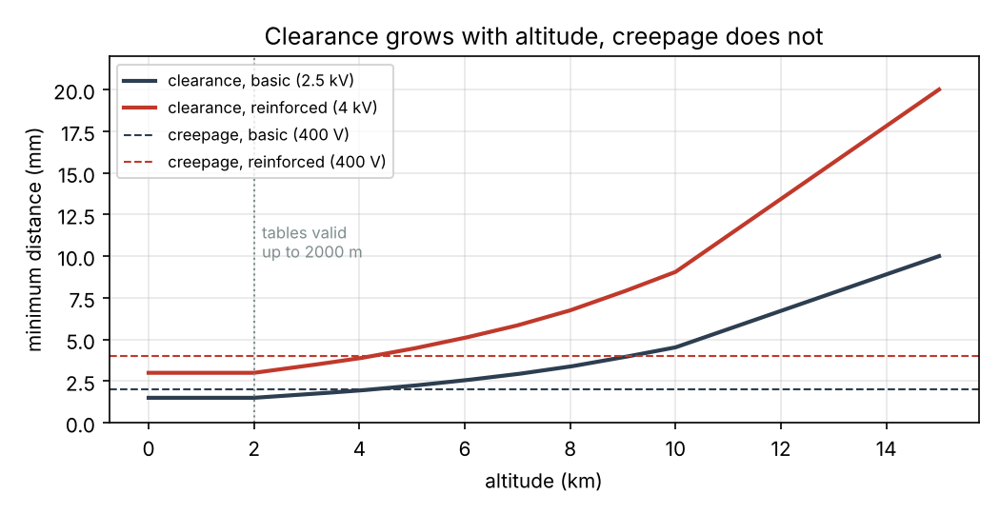

# Example 5 — PCB rules: traces, vias and insulation (illustrative values)

## 1. Trace width (IPC-2221)

Minimum width for a temperature rise of 10 °C and 20 °C above the board.

| Current | 1 oz external, 10 °C | 1 oz external, 20 °C | 2 oz external, 10 °C | 1 oz internal, 10 °C | Ø0.3 mm vias needed, 10 °C |
| --- | --- | --- | --- | --- | --- |
| 1 A | 0.30 mm | 0.20 mm | 0.15 mm | 0.78 mm | 2 |
| 2 A | 0.78 mm | 0.51 mm | 0.39 mm | 2.03 mm | 3 |
| 5 A | 2.77 mm | 1.82 mm | 1.38 mm | 7.19 mm | 6 |
| 10 A | 7.19 mm | 4.72 mm | 3.60 mm | 18.72 mm † | 12 |

† Wider than 400 mil (10.2 mm): outside the range of the IPC-2221 fit, an extrapolation.

One via drilled Ø0.3 mm with 25 µm of plating (grown inside the hole) carries about 0.84 A for a 10 °C rise. A 5 A trace of 2.8 mm and 50 mm long has 10.3 mΩ at 60 °C: 51 mV and 257 mW.

IPC-2221 is conservative for internal layers. IPC-2152, its successor, shows that a buried trace in a real board, with planes nearby, runs nearly as cool as an external one: use it, or a thermal simulation, when the internal widths above do not fit.

## 2. Clearance and creepage (IEC 60664-1)

Converter supplied from a single-phase 230 V network through a PFC stage that regulates its DC link at 400 V: line-to-neutral 230 V, overvoltage category II, so a rated impulse voltage of 2.5 kV. Pollution degree 2 (non-conductive pollution, occasional condensation). Working voltage across the barrier: the 400 V DC link. The board is the insulating material (printed wiring columns). A three-phase 400 V supply would give a DC link around 565 V, and longer creepage distances.

| Altitude | Basic: clearance / creepage | Reinforced (DC link to SELV control): clearance / creepage |
| --- | --- | --- |
| 0 m | 1.50 / 2.00 mm | 3.00 / 4.00 mm |
| 2000 m | 1.50 / 2.00 mm | 3.00 / 4.00 mm |
| 3000 m | 1.71 / 2.00 mm | 3.42 / 4.00 mm |
| 4000 m | 1.94 / 2.00 mm | 3.87 / 4.00 mm |
| 5000 m | 2.22 / 2.22 mm | 4.44 / 4.44 mm |

Reinforced insulation takes the clearance of the next rated impulse voltage (4 kV) and doubles the creepage. Creepage depends on the working voltage and does not change with altitude; clearance does, and once it exceeds the creepage it sets both, since a surface path can never be shorter than the air gap it bridges.

Up to 2000 m the tables apply directly. Above, the factor grows quickly: at 10 000 m it is 3.02. For equipment in an unpressurised bay, a conformal coating, potting or a dedicated analysis (partial discharge, Paschen curve) usually replaces the air distances.

These distances are a minimum from the basic safety standard: the product standard (IEC 62477-1 for power converters, IEC 61010-1, IEC 62368-1...) can require more, and the values here must be checked against the edition of the standard in force.

